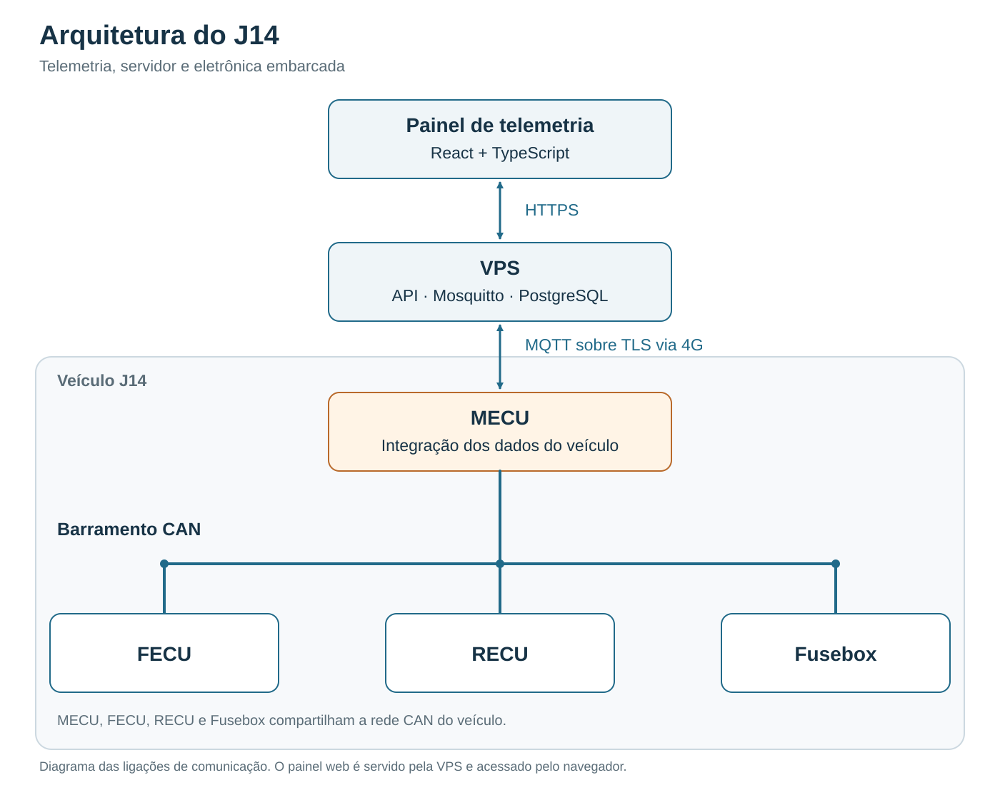

# Equipe Imperador de Baja SAE

Bem-vindo ao GitHub da Equipe Imperador! Aqui reunimos os projetos desenvolvidos pelo subsistema de eletrônica: sistemas embarcados, aquisição de dados, comunicação e ferramentas de telemetria para os nossos veículos.

## J14

O J14 integra a eletrônica do veículo à plataforma de telemetria da equipe. A MECU faz a ligação entre a rede CAN embarcada e a VPS, permitindo que os dados do carro sejam disponibilizados no painel web.

Na rede do veículo, **MECU, FECU, RECU e Fusebox** se comunicam pelo barramento CAN. O firmware embarcado e os componentes do servidor são mantidos em repositórios separados.

| Repositório | Conteúdo |
|---|---|
| [Firmware-ECUs-SUL-2026](https://github.com/Equipe-Imperador/Firmware-ECUs-SUL-2026) | Firmware das unidades eletrônicas do veículo. |
| [telemetriaimbaja](https://github.com/Equipe-Imperador/telemetriaimbaja) | Frontend React/TypeScript, backend Node.js/TypeScript, estrutura e migrações do PostgreSQL, configurações da VPS e scripts de operação. |

### Arquitetura do sistema

O painel web é servido pela VPS e acessado pelo navegador. O diagrama apresenta as ligações de comunicação; a rede CAN é compartilhada pelas unidades do veículo.

[Versão editável do diagrama em Mermaid](https://github.com/Equipe-Imperador/.github/blob/main/profile/assets/arquitetura-j14.mmd)

## J13.2

O J13.2 já utilizava uma arquitetura com **quatro ECUs: MECU, RECU, FECU e PTECU**. Os firmwares eram mantidos por unidade, enquanto o servidor de telemetria e a interface web eram organizados em dois repositórios próprios.

| Componente | Repositório |
|---|---|
| MECU | [MECU_NACIONAL26](https://github.com/Equipe-Imperador/MECU_NACIONAL26) |
| RECU | [RECU_NACIONAL26](https://github.com/Equipe-Imperador/RECU_NACIONAL26) |
| FECU | [FECU_NACIONAL26](https://github.com/Equipe-Imperador/FECU_NACIONAL26) |
| PTECU | [PTECU_NACIONAL26](https://github.com/Equipe-Imperador/PTECU_NACIONAL26) |
| Backend da telemetria | [imperador-backend](https://github.com/Equipe-Imperador/imperador-backend) |
| Frontend da telemetria | [imperador-frontend](https://github.com/Equipe-Imperador/imperador-frontend) |

No J14, os componentes da VPS passaram a ser reunidos no `telemetriaimbaja`, mantendo o firmware do veículo em seu repositório próprio. Os repositórios do J13.2 preservam a organização e o histórico dessa configuração.

## J12

O projeto de eletrônica do J12 foi uma inovação dentro da equipe. Migrou-se de três ECUs para duas, adotando como filosofia a simplificação do projeto através da centralização. Foi a primeira vez que foram desenvolvidas placas com o ESP32, permitindo maior capacidade de processamento. Através desse projeto, a equipe conquistou o inédito 1º lugar do Regional Sul e o 2º lugar Nacional nos banners de eletrônica.

Os repositórios utilizados foram:

- [ECU Central](https://github.com/Equipe-Imperador/ECU-Central)
- [Software de Telemetria](https://github.com/Equipe-Imperador/Telemetria)
- [ECU Painel](https://github.com/Equipe-Imperador/Painel_J13)

## Documentação e histórico

- [Documentação eletrônica do J13](https://github.com/Equipe-Imperador/documentacao_eletronica_j13)
- [Firmware ECU V3](https://github.com/Equipe-Imperador/ecu_v3_firmware)
- [Hardware ECU V3](https://github.com/Equipe-Imperador/ecu_v3_hardware)
- [Servidor de versões anteriores](https://github.com/Equipe-Imperador/Servidor)

Alguns repositórios possuem acesso restrito aos integrantes autorizados da equipe.
